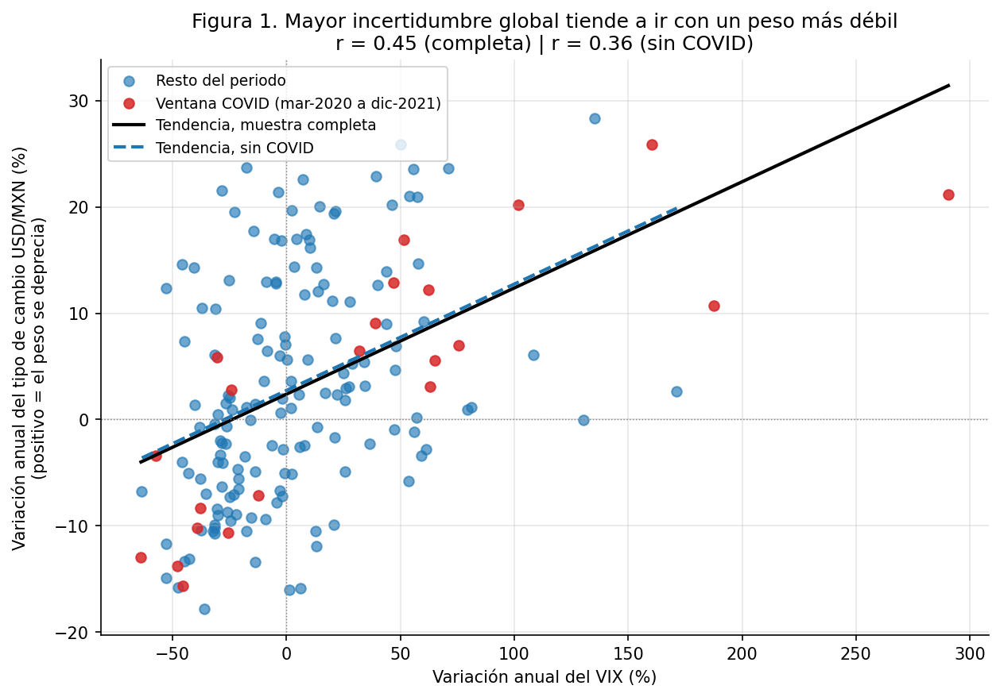
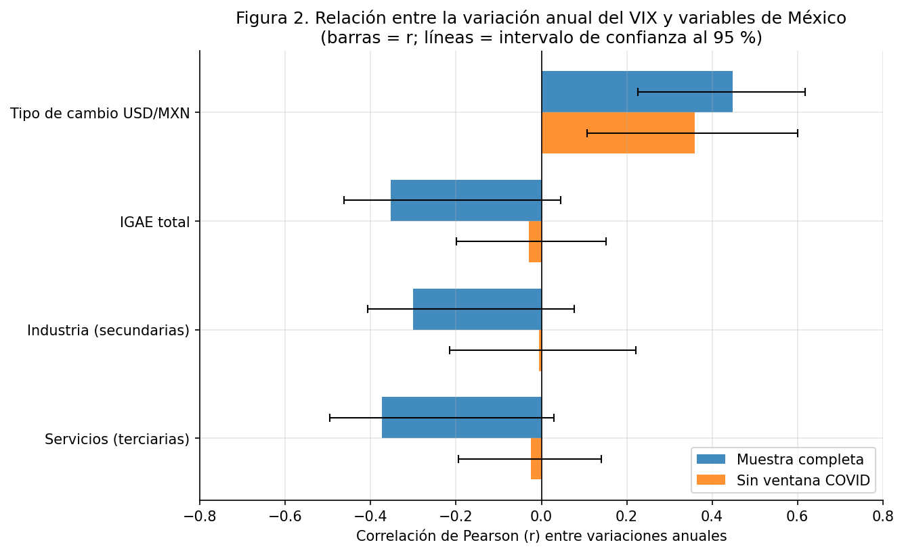
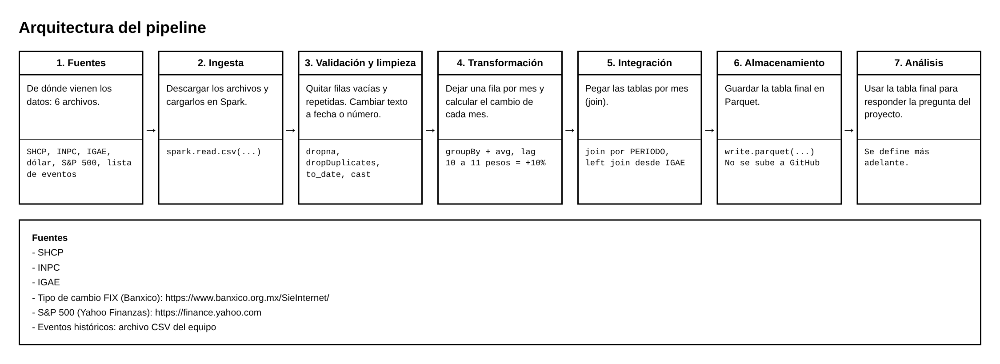

# Impacto de Eventos Macroeconómicos Globales en la Economía Mexicana: Un Análisis Multidimensional con PySpark

## ¿De qué trata este proyecto?

Cuando los mercados financieros de Estados Unidos se agitan, sus efectos no se quedan allá. México los siente en cosas cotidianas: el dólar se encarece o abarata, los precios suben o bajan, el gobierno recauda y gasta distinto y la actividad económica se acelera o se frena.

Este proyecto mide, con datos públicos, qué tanto se asocian las condiciones financieras globales (el índice bursátil S&P 500 y el índice de volatilidad VIX) con el **tipo de cambio, la inflación, las finanzas públicas y la actividad económica de México**. Para ello se reúnen y limpian las fuentes, se integran mes a mes con **Apache Spark (PySpark)** y se consume el resultado con consultas en Spark SQL y análisis estadístico.

**Alcance temporal.** El análisis cubre de **enero de 2011 a julio de 2026** (187 meses), que es el periodo en que coinciden todas las fuentes (las finanzas públicas de la SHCP empiezan en 2011). El episodio global más relevante dentro de ese periodo es la pandemia de COVID-19 (2020-2021). Las crisis anteriores a 2011 quedan fuera por cobertura de datos.

¿Por qué importa? Entender cuánto y cuándo reacciona la economía ante la incertidumbre internacional ayuda a identificar qué tan expuesta está México y a leer con mejor criterio los momentos de volatilidad.

Utilizando **Apache Spark (PySpark)** como motor de procesamiento distribuido, se integran series de tiempo históricas de finanzas públicas, precios y actividad económica nacional con indicadores financieros internacionales clave.

## Pregunta de investigación

¿Cómo se asocian las condiciones financieras globales (S&P 500 y VIX) con el tipo de cambio, la inflación, las finanzas públicas y la actividad económica de México entre 2011 y 2026?

## Objetivo general

Construir un pipeline modular y reproducible con PySpark que integre fuentes económicas nacionales e indicadores financieros internacionales en un dataset mensual validado, y consumirlo mediante consultas e indicadores que permitan comunicar hallazgos sustentados y sus limitaciones.

---

## Resultados clave

Los resultados completos están en [notebooks/07_etapa_c_hallazgos.ipynb](notebooks/07_etapa_c_hallazgos.ipynb). Se analizan variaciones anuales (a 12 meses) con intervalos de confianza al 95 % por *bootstrap* de bloques, y cada resultado se reporta con y sin el periodo COVID (marzo 2020 a diciembre 2021).

| Hallazgo | Resultado | Conclusión |
| --- | --- | --- |
| **VIX vs. tipo de cambio** | r = +0.45 (IC 95 %: +0.23 a +0.62); sin COVID r = +0.36 | **Robusto.** Los años de mayor incertidumbre global tienden a coincidir con un peso más débil |
| **VIX vs. actividad económica (IGAE)** | r = −0.35 con COVID; r ≈ −0.03 sin COVID. El intervalo incluye el cero | **Depende del COVID.** La relación aparente desaparece al excluir 2020-2021 |
| **S&P 500: promedio mensual vs. cierre** | La ventaja del promedio (+0.11) no se sostiene sin COVID y el signo de la relación cambia | **No concluyente** |
| **Tipo de cambio vs. inflación** | r = −0.46 en el mismo mes; sin traspaso visible en horizontes de hasta aproximadamente año y medio | **Sin traspaso visible** con estas series |
| **Finanzas públicas reales** | Correlaciones cercanas a cero con VIX, S&P 500 y tipo de cambio | **Sin relación observable** (series muy volátiles) |





Interpretación en lenguaje sencillo: el vínculo más claro entre el nerviosismo de los mercados de EE.UU. y México es el **tipo de cambio**. En la actividad económica no se detecta una conexión estable fuera del periodo COVID, por lo que no conviene atribuir al VIX una caída que corresponde a un choque sanitario. Las relaciones encontradas son **moderadas** y describen **asociación, no causalidad**.

---

## Fuentes de información

El proyecto parte de cinco fuentes. El detalle de cada una (variables, periodicidad, justificación y alternativas evaluadas) está en [docs/fuentes.md](docs/fuentes.md).

### Fuentes base del curso (consolidadas en el Laboratorio 8)

1. **SHCP (Finanzas Públicas):** Ingresos (`XBB`) y Gastos (`XBC`) del Gobierno Federal (claves de las series).
2. **INEGI (INPC):** Índice Nacional de Precios al Consumidor, para deflactar y calcular inflación.
3. **INEGI (IGAE):** Indicador Global de la Actividad Económica por sectores productivos.

Estas tres fuentes se integraron en un único Parquet mensual (`finanzas_igae_mensual_final.parquet`) que el pipeline consume como entrada.

### Fuentes adicionales integradas

1. **Tipo de cambio USD/MXN:** Banco de México, serie SF43718 (FIX). Indicador de presión cambiaria.
2. **Índice S&P 500 y VIX:** obtenidos con la librería `yfinance` de Yahoo Finanzas (`^GSPC` para el S&P 500 y el índice de volatilidad VIX de CBOE). Indicadores de apetito por riesgo y de incertidumbre global. Justificación en [docs/fuentes.md](docs/fuentes.md).

---

### Cómo obtener los datos

Los datos originales **no se almacenan en este repositorio**. Para reproducir el proyecto, genérenlos y colóquenlos en `data/raw/`.

| Fuente | Acceso | Periodicidad | Cobertura | Archivo en `data/raw/` |
| --- | --- | --- | --- | --- |
| SHCP + INPC + IGAE | A través del INEGI. (https://www.inegi.org.mx/temas/inpc/), (https://www.inegi.org.mx/temas/igae/) Datos abiertos de la SHCP (https://www.datos.gob.mx/organization/secretaria_hacienda) y series (`XBB`, `XBC`)| Mensual | 2011-01 a 2026-07 (187 meses) | `finanzas_igae_mensual_final.parquet` |
| Tipo de cambio FIX (Banxico, SF43718) | Notebook [01_descarga_tipo_cambio.ipynb](notebooks/01_descarga_tipo_cambio.ipynb), que usa la API REST del SIE (https://www.banxico.org.mx/SieAPIRest/service/v1/). Requiere token gratuito | Diaria (se agrega a mensual en el pipeline) | 12-nov-1991 a la fecha de ejecución | `tipo_cambio_fix.csv` |
| S&P 500 y VIX | Notebook [02_descarga_sp&500_mensual.ipynb](notebooks/02_descarga_sp%26500_mensual.ipynb), con `yfinance` (`pip install yfinance`), sin token | Mensual | Desde 1990-01-01 | `s&p500_mensual.csv` |

**Token de la API de Banxico:** no se sube al repositorio. Cada integrante debe solicitar su propio token gratuito en el sitio del SIE y guardarlo en la variable de entorno `BANXICO_TOKEN`, que es la que lee el notebook:

```bash
# macOS / Linux
export BANXICO_TOKEN="<su_token>"

# Windows (PowerShell)
$env:BANXICO_TOKEN = "<su_token>"
```

---

## Arquitectura y etapas del procesamiento

Recorrido completo de los datos: **fuentes → procesamiento con PySpark → datos almacenados → mecanismo de consulta → resultado analítico**.


 
*Diagrama completo en [docs/arquitectura.png](docs/arquitectura.png).*

El pipeline tiene siete etapas, de las fuentes al análisis:

| Etapa | Qué se hace | Herramientas | Dónde vive |
| --- | --- | --- | --- |
| 1. Fuentes | Se reúnen las fuentes de origen: SHCP, INPC, IGAE, dólar y S&P 500 con VIX | N/A | `data/raw/` |
| 2. Ingesta | Cargar el Parquet del Laboratorio 8 y los CSV externos con esquemas explícitos | `spark.read`, `StructType` | [`src/ingestion/extract.py`](src/ingestion/extract.py) |
| 3. Validación y limpieza | Verificar columnas, tipos, nulos y duplicados; quitar valores `"N/E"`; convertir texto a fecha o número | `filter`, `to_date`, `cast` | [`src/quality/validate.py`](src/quality/validate.py) y [`src/transformations/integrate_enrich.py`](src/transformations/integrate_enrich.py) |
| 4. Transformación | Dejar una fila por mes: último valor hábil del tipo de cambio y fecha del S&P 500 al inicio de mes | `groupBy`, `F.max_by`, `F.trunc` | [`src/transformations/integrate_enrich.py`](src/transformations/integrate_enrich.py) |
| 5. Integración | Unir las tablas por mes (`PERIODO`) | `join` interno con `F.broadcast()` | [`src/transformations/integrate_enrich.py`](src/transformations/integrate_enrich.py) |
| 6. Almacenamiento | Guardar la tabla final en Parquet (no se sube a GitHub) | `write.parquet(...)` | `data/processed/` |
| 7. Consumo analítico | Consultas en Spark SQL y análisis de variaciones anuales sobre la tabla final | Spark SQL, `pandas`, `matplotlib` | `notebooks/` (06 y 07) [`notebooks/06_etapa_b_capa_consumo.ipynb`](notebooks/06_etapa_b_capa_consumo.ipynb),[`notebooks/07_etapa_c_hallazgos.ipynb`](notebooks/07_etapa_c_hallazgos.ipynb)   y  [`reports/`](reports/figures/)|

Los rendimientos (variaciones a 12 meses) **no se calculan en el ETL**, sino en la capa de consumo (notebook 07), para no procesar dos veces información ya preparada.

**¿Por qué *inner join*?** Las tres fuentes se cruzan por mes con una relación 1:1. El inner join con `broadcast` conserva exactamente los 187 meses en que coinciden todas las series (2011-2026) y garantiza que el dataset final no tenga nulos. Como consecuencia, el análisis queda acotado a ese periodo.

---

## Estado actual del desarrollo

| Componente | Estado | Comentario |
| --- | --- | --- |
| Definición del proyecto y roles | Terminado | [docs/roles.md](docs/roles.md) |
| Fuentes de datos (selección y justificación) | Terminado | [docs/fuentes.md](docs/fuentes.md) |
| Diagrama de arquitectura | Terminado | Diagrama en este README y en [docs/arquitectura.png](docs/arquitectura.png) |
| Descarga del tipo de cambio (Banxico) | Terminado | [Notebook 01](notebooks/01_descarga_tipo_cambio.ipynb): `8,791` registros desde `1991-11-12`, en `data/raw/tipo_cambio_fix.csv` |
| Descarga del S&P 500 y VIX | Terminado | [Notebook 02](notebooks/02_descarga_sp%26500_mensual.ipynb): `442` registros mensuales desde `1990-01-01`, en `data/raw/s&p500_mensual.csv` |
| Código reutilizable en `src/` | Terminado | [`extract.py`](src/ingestion/extract.py), [`validate.py`](src/quality/validate.py), [`integrate_enrich.py`](src/transformations/integrate_enrich.py) y orquestador [`pipeline.py`](pipeline.py) |
| Ingesta, validación y limpieza | Terminado | Esquemas explícitos (`StructType`), limpieza de `"N/E"`, mensualización con `F.max_by()` y contratos de calidad de entrada, intermedia y salida |
| Transformación e integración final | Terminado | Clave temporal `PERIODO`, cruce `1:1` con *Inner Join* y `F.broadcast()`; evidencia en [`reports/ultima_ejecucion.json`](reports/ultima_ejecucion.json) |
| Almacenamiento en Parquet | Terminado | `187` registros y `12` columnas (`0` nulos) en `data/processed/proyecto_integrado_mensual.parquet`, verificados en disco |
| Verificación del pipeline (Actividad 12, Etapa A) | Terminado | [Notebook 03](notebooks/03_etapa_a_demostracion_pipeline.ipynb) |
| Exploración del tipo de cambio y del S&P 500 | Terminado | [Notebook 04](notebooks/04_analisis_tipo_cambio.ipynb) y [Notebook 05](notebooks/05_analisis_sp500.ipynb) |
| Capa de consumo analítico (Etapa B) | Terminado | [Notebook 06](notebooks/06_etapa_b_capa_consumo.ipynb): tres consultas en Spark SQL |
| Interpretación y comunicación (Etapa C) | Terminado | [Notebook 07](notebooks/07_etapa_c_hallazgos.ipynb), figuras en `reports/figures/` y tablas en `reports/tablas_etapa_c/` |

---

## Estructura del repositorio

```text
Proyecto_Integrador_PGBD/
├── data/                # Datos de entrada y procesados (no se suben a GitHub)
│   ├── raw/             # Datos originales
│   └── processed/       # Datos transformados (Parquet)
├── src/                 # Código modular reutilizable
│   ├── ingestion/       # Lectura y carga (extract.py)
│   ├── transformations/ # Limpieza e integración (integrate_enrich.py)
│   └── quality/         # Validaciones (validate.py)
├── notebooks/           # Descarga, verificación, consumo y análisis (01 a 07)
├── docs/                # Arquitectura, fuentes, roles y guía de optimización
├── reports/             # Resultados y evidencias
│   ├── ultima_ejecucion.json
│   ├── figures/         # Figuras de la Etapa C
│   └── tablas_etapa_c/  # Tablas de resultados (CSV)
├── pipeline.py          # Orquestador del pipeline
├── README.md            # Presentación y navegación
├── requirements.txt     # Dependencias
└── .gitignore           # Exclusiones de Git
```

---

## Tecnologías utilizadas

- **Lenguajes y entorno:** Python 3.14, Jupyter Notebook.
- **Procesamiento distribuido:** Apache Spark (PySpark): DataFrames, Spark SQL, Catalyst Optimizer, Spark UI.
- **Descarga y manejo de datos:** `requests` y `pandas` (API de Banxico), `yfinance` (S&P 500 y VIX).
- **Análisis y visualización:** `pandas`, `numpy` y `matplotlib`.
- **Almacenamiento:** formato Parquet (lectura con `pyarrow`).
- **Control de versiones y colaboración:** Git y GitHub (estrategia Feature-Branch / Pull Requests).

---

## Pipeline modular de datos

El flujo de procesamiento transforma y consolida las fuentes económicas nacionales y los indicadores financieros internacionales en un conjunto de datos mensual único (`1:1`), validado y reproducible de principio a fin bajo el patrón:

> `Extract` → `Validate` → `Transform & Integrate` → `Validate` → `Load` → `Verify`

### 1. Estructura modular del código

- [`src/ingestion/extract.py`](src/ingestion/extract.py): lectura del Parquet integrado del Laboratorio 8 y carga de los CSV externos mediante esquemas explícitos (`StructType`) para proteger el contrato de tipos desde la ingesta.
- [`src/quality/validate.py`](src/quality/validate.py): contratos de calidad de entrada, intermedia y salida que detienen la ejecución si faltan columnas, hay tipos incorrectos, aparecen nulos o se detectan periodos duplicados.
- [`src/transformations/integrate_enrich.py`](src/transformations/integrate_enrich.py): limpieza de registros, mensualización del tipo de cambio diario, homologación de la clave temporal (`PERIODO`) e integración mediante *Inner Join* con `F.broadcast()`.
- [`pipeline.py`](pipeline.py): orquestador principal en la raíz del proyecto; coordina las etapas, etiqueta la ejecución en Spark UI con `setJobGroup()` y genera el registro de evidencia en [`reports/ultima_ejecucion.json`](reports/ultima_ejecucion.json).

### 2. Fuentes utilizadas y conteos de entrada (`data/raw/`)

| Fuente | Archivo local | Origen | Frecuencia original | Registros de entrada |
| :--- | :--- | :--- | :--- | :---: |
| **SHCP + INPC + IGAE** | `finanzas_igae_mensual_final.parquet` | Producto integrado del Laboratorio 8 | Mensual | **187** |
| **Tipo de cambio USD/MXN** | `tipo_cambio_fix.csv` | [Banxico](https://www.banxico.org.mx/SieAPIRest/service/v1/) (serie `SF43718`, desde `1991-11-12`) | Diaria | **8,791** |
| **S&P 500 y VIX** | `s&p500_mensual.csv` | [Yahoo Finance](https://finance.yahoo.com/quote/%5EGSPC/) (desde `1990-01-01`) | Mensual | **442** |

> **Nota:** los archivos de `data/` se excluyen del repositorio mediante `.gitignore`; los CSV externos se generan ejecutando los notebooks [`01_descarga_tipo_cambio.ipynb`](notebooks/01_descarga_tipo_cambio.ipynb) y [`02_descarga_sp&500_mensual.ipynb`](notebooks/02_descarga_sp%26500_mensual.ipynb).

### 3. Decisiones principales de limpieza y transformación

1. **Limpieza y mensualización del tipo de cambio (`TC_CIERRE`):**
   - Se filtraron registros nulos o marcados como `"N/E"` en la columna `dato`.
   - Se convirtió `fecha` de texto (`dd/MM/yyyy`) a tipo `date` y `dato` a `double`, truncando cada fecha al primer día del mes (`PERIODO = YYYY-MM-01`).
   - Se agrupó por `PERIODO` con `F.max_by("tc_valor", "fecha_dt")` para conservar el valor del último día hábil disponible de cada mes.
2. **Homologación temporal del S&P 500 y el VIX:**
   - El archivo registra las observaciones al último día calendario del mes. Se aplicó `F.trunc(..., "month")` sobre `fecha` para alinear su clave `PERIODO` al primer día del mes.
   - Se conservan `SP500_CIERRE`, `SP500_PROMEDIO` (media mensual de las cotizaciones diarias) y `VIX_CIERRE`.
3. **Integración `1:1` optimizada:**
   - Se integraron las tres fuentes con *Inner Join* sobre `PERIODO`.
   - Al ser series mensuales compactas, el tipo de cambio y el S&P 500 se envolvieron con `F.broadcast()` para que Catalyst use `BroadcastHashJoin` y evite *shuffles* innecesarios.

### 4. Reglas de validación y resultados obtenidos

- **Validación de entradas** (`validate_lab8_input`, `validate_tc_input`, `validate_sp500_input`): existencia de las columnas requeridas (8 columnas base en el Parquet del Laboratorio 8), tipos numéricos válidos y unicidad mensual (`0` meses duplicados).
- **Validación intermedia** (`validate_prepared_monthly`): exactamente `1` fila por `PERIODO` en `TC_MENSUAL` y `SP500_MENSUAL` antes de los *joins*.
- **Validación de salida** (`validate_output`): esquema final de `12` columnas, conservación de cardinalidad (sin multiplicaciones `N:M`), unicidad estricta de `PERIODO` y `0` valores nulos.
- **Verificación en disco** (`verify_persisted_output`): relectura automática del Parquet guardado para confirmar que su esquema y conteo coinciden con lo procesado.
- **Evidencia de ejecución** ([`reports/ultima_ejecucion.json`](reports/ultima_ejecucion.json)): última corrida con `"estado": "OK"`, `"error": null` y **187 registros** integrados.
- **Prueba negativa:** el [notebook 03](notebooks/03_etapa_a_demostracion_pipeline.ipynb) simula un duplicado y demuestra que el contrato de calidad detiene el flujo.

### 5. Conjunto de datos generado (salida)

- **Ubicación:** `data/processed/proyecto_integrado_mensual.parquet`
- **Granularidad y periodo:** **187 registros**, una fila por mes (`PERIODO` de enero de 2011 a julio de 2026), **12 columnas** y **0 valores nulos**.

| Columna | Tipo | Descripción |
| :--- | :--- | :--- |
| `PERIODO` | `date` | Primer día del mes (`YYYY-MM-01`), clave temporal única (`1:1`). |
| `INGRESOS_REALES` | `double` | Ingresos del Gobierno Federal (`XBB`) deflactados con el INPC (precios constantes de dic-2025). |
| `GASTOS_REALES` | `double` | Gasto total del Gobierno Federal (`XBC`) deflactado con el INPC. |
| `INPC` | `double` | Índice Nacional de Precios al Consumidor (base dic-2025). |
| `Total` | `double` | Índice IGAE total nacional (base 2018 = 100). |
| `Actividades primarias` | `double` | Índice IGAE del sector primario (campo). |
| `Actividades secundarias` | `double` | Índice IGAE del sector secundario (industria y manufactura). |
| `Actividades terciarias` | `double` | Índice IGAE del sector terciario (comercio y servicios). |
| `TC_CIERRE` | `double` | Tipo de cambio FIX USD/MXN al cierre hábil de cada mes. |
| `SP500_CIERRE` | `double` | Índice S&P 500 al cierre de cada mes. |
| `SP500_PROMEDIO` | `double` | Promedio mensual de las cotizaciones diarias del S&P 500. |
| `VIX_CIERRE` | `double` | Índice de volatilidad VIX (CBOE) al cierre de cada mes. |

---

## Capa de consumo analítico

El dataset final se consume **sin repetir el ETL**: las consultas leen directamente el Parquet de `data/processed/`.

### Preguntas analíticas

Las consultas se implementan en Spark SQL en el [notebook 06](notebooks/06_etapa_b_capa_consumo.ipynb), sobre la tabla temporal `macro_mexico`.

1. **Estrés financiero global:** ¿cómo se comportaron el balance fiscal real (`INGRESOS_REALES - GASTOS_REALES`), la industria (`Actividades secundarias`) y el tipo de cambio en los meses de alta incertidumbre global (`VIX_CIERRE >= 25`)?
2. **Evolución anual:** ¿cuál fue el promedio anual del tipo de cambio, del S&P 500, del VIX y de la actividad económica, y el balance de ingresos y gastos reales, entre 2011 y 2026? *(2026 es un año parcial: enero a julio.)*
3. **Regímenes de volatilidad:** ¿cómo cambian el tipo de cambio, la actividad industrial y de servicios y el balance fiscal según el régimen de VIX (calma `< 15`, media `15 a 25`, estrés `>= 25`)?

### Qué se prepara una sola vez y qué se calcula al consultar

| Criterio | Preparado una sola vez en el pipeline (ETL) | Calculado al consultar |
| :--- | :--- | :--- |
| **Transformaciones** | Limpieza (`N/E`), conversión de tipos y estandarización de `PERIODO` | Agrupaciones anuales, filtros (`VIX >= 25`), clasificación por régimen y balance fiscal |
| **Granularidad** | De 8,791 registros diarios de tipo de cambio a 187 meses con `max_by` | Promedios y sumas por año o por régimen |
| **Integración de fuentes** | Cruce de las tres fuentes con `BroadcastHashJoin` | Consultas sobre una sola tabla lógica, sin nuevos *joins* |
| **Rendimientos** | No se calculan en el ETL | Variaciones a 12 meses y correlaciones (notebook 07) |

### Análisis estadístico y comunicación

Los notebooks [04](notebooks/04_analisis_tipo_cambio.ipynb) y [05](notebooks/05_analisis_sp500.ipynb) exploran el tipo de cambio y el S&P 500. El [notebook 07](notebooks/07_etapa_c_hallazgos.ipynb) consolida los hallazgos con figuras y tablas guardadas en `reports/`.

---

## Limitaciones

- **Correlación no es causalidad.** Dos variables pueden moverse juntas por un tercer factor ausente del dataset (tasas de interés, petróleo, política monetaria). Se usa lenguaje de asociación.
- **Variaciones a 12 meses traslapadas.** Las observaciones consecutivas comparten información, por lo que la muestra efectiva es menor a 175 meses. Se usan intervalos de confianza por *bootstrap* de bloques.
- **Periodo COVID.** Marzo 2020 a diciembre 2021 genera valores extremos que pueden dominar una correlación; por eso cada resultado se reporta con y sin esa ventana.
- **Cobertura temporal.** Enero 2011 a julio 2026; el último año es parcial y hay pocos ciclos económicos completos. No se evalúan las crisis anteriores a 2011.
- **Magnitud de las relaciones.** La mayoría de las correlaciones son moderadas o bajas; no deben presentarse como "determinantes".
- **Sin variables de control.** No se aísla el efecto del VIX de otros factores simultáneos; un modelo multivariado queda como trabajo futuro.
- **Calidad del dato.** Los ingresos y gastos reales dependen del deflactor INPC y pueden contener partidas extraordinarias; sus series son muy volátiles.
- **Alcance de las conclusiones.** El análisis es descriptivo del pasado; no permite pronosticar.

---

## Arquitectura aplicada: almacenamiento, reutilización y evolución

**Dónde se almacenan los datos y cómo se reutilizan.** Los datos originales viven en `data/raw/` y el resultado del pipeline se guarda en un único archivo Parquet local en `data/processed/`. Ese Parquet es la **fuente única** para todo el consumo: el notebook 06 lo expone como tabla temporal de Spark SQL y los notebooks 04, 05 y 07 lo leen directamente, sin volver a ejecutar la limpieza ni los *joins*. Los resultados (figuras y tablas) se guardan en `reports/`. Los datos no se suben a GitHub; el repositorio conserva el código y las evidencias.

**Qué está implementado y qué sería una evolución.** Hoy el proyecto usa almacenamiento local en Parquet y consultas con Spark SQL en modo local. No se implementó un Data Lake, un Data Warehouse ni un Lakehouse porque el dataset es pequeño (187 filas) y no se justifica la complejidad adicional. Posibles evoluciones, si el volumen o el número de usuarios crecieran:

- **Data Lake:** almacenar `raw` y `processed` en almacenamiento de objetos en la nube, con zonas separadas.
- **Data Warehouse:** modelar tablas dimensionales para consultas analíticas con muchos usuarios simultáneos.
- **Lakehouse:** añadir un formato transaccional (por ejemplo, Delta Lake) sobre Parquet para actualizaciones y control de versiones de los datos.

**Cómo se incorporarían datos nuevos o correcciones.** Para nuevos meses basta volver a ejecutar los notebooks de descarga (01 y 02), actualizar el Parquet del Laboratorio 8 y volver a correr `pipeline.py`: los contratos de calidad validan la nueva entrada y el Parquet de salida se regenera completo. Una corrección en la fuente o en la lógica de limpieza sigue el mismo camino: se corrige el módulo correspondiente de `src/` y se reejecuta el pipeline. No se implementó una carga incremental porque, con este volumen, regenerar el dataset completo es rápido y más simple.

---

## Cómo ejecutar el proyecto

```bash
# 1. Clonar el repositorio
git clone https://github.com/JuliaDomRuss/Proyecto_Integrador_PGBD.git
cd Proyecto_Integrador_PGBD

# 2. Instalar dependencias
pip install -r requirements.txt

# 3. Configurar el token de Banxico (ver "Cómo obtener los datos")
export BANXICO_TOKEN="<su_token>"   # en PowerShell: $env:BANXICO_TOKEN = "<su_token>"
```

**4. Preparar los datos de entrada.** Ejecutar los notebooks `01_descarga_tipo_cambio.ipynb` y `02_descarga_sp&500_mensual.ipynb`, y verificar que en `data/raw/` estén `finanzas_igae_mensual_final.parquet`, `tipo_cambio_fix.csv` y `s&p500_mensual.csv`.

**5. Ejecutar el pipeline** desde la raíz del proyecto (donde está `pipeline.py`):

```bash
spark-submit --master "local[*]" pipeline.py
```

Genera `data/processed/proyecto_integrado_mensual.parquet` y `reports/ultima_ejecucion.json`.

**6. Ejecutar el consumo analítico**, en este orden:

| Notebook | Propósito |
| --- | --- |
| `03_etapa_a_demostracion_pipeline.ipynb` | Verificar el pipeline y la calidad del dataset |
| `04_analisis_tipo_cambio.ipynb` y `05_analisis_sp500.ipynb` | Exploración del tipo de cambio y del S&P 500 |
| `06_etapa_b_capa_consumo.ipynb` | Consultas en Spark SQL |
| `07_etapa_c_hallazgos.ipynb` | Hallazgos, figuras y tablas |

```bash
jupyter notebook notebooks/
```

Para generar una versión en HTML de un notebook con sus resultados: `jupyter nbconvert --to html --execute notebooks/07_etapa_c_hallazgos.ipynb`.

---

## Evidencias

- Ejecución del pipeline: [`reports/ultima_ejecucion.json`](reports/ultima_ejecucion.json).
- Verificación y prueba negativa de calidad: [notebook 03](notebooks/03_etapa_a_demostracion_pipeline.ipynb).
- Consultas de consumo: [notebook 06](notebooks/06_etapa_b_capa_consumo.ipynb).
- Hallazgos, figuras y tablas: [notebook 07](notebooks/07_etapa_c_hallazgos.ipynb), `reports/figures/` y `reports/tablas_etapa_c/`.
- Revisión de cambios: Pull Request correspondiente a la Actividad 12 (descripción y observaciones del revisor).

---

## Flujo de trabajo en GitHub

Ningún integrante hace `push` directo a `main`: cada cambio va en una rama (por ejemplo `docs/actualizacion-readme`) y se integra con un Pull Request semanal revisado por los Technical Reviewers. Los detalles y reglas están en [docs/roles.md](docs/roles.md).

---

## Documentación

- [Arquitectura](docs/arquitectura.png)
- [Fuentes de datos](docs/fuentes.md)
- [Roles y reglas de colaboración](docs/roles.md)
- [Guía de optimización](docs/guia_optimizacion.md)
- [Notebook 01: descarga del tipo de cambio](notebooks/01_descarga_tipo_cambio.ipynb)
- [Notebook 02: descarga del S&P 500 y VIX](notebooks/02_descarga_sp%26500_mensual.ipynb)
- [Notebook 03: verificación del pipeline](notebooks/03_etapa_a_demostracion_pipeline.ipynb)
- [Notebook 04: análisis del tipo de cambio](notebooks/04_analisis_tipo_cambio.ipynb)
- [Notebook 05: análisis del S&P 500](notebooks/05_analisis_sp500.ipynb)
- [Notebook 06: capa de consumo analítico](notebooks/06_etapa_b_capa_consumo.ipynb)
- [Notebook 07: hallazgos e interpretación](notebooks/07_etapa_c_hallazgos.ipynb)

---

## Integrantes y roles

| Integrante | Rol principal | Área de responsabilidad general |
| --- | --- | --- |
| **Julia María Domínguez Russell** | **Developer Lead** | Coordinación técnica de código PySpark, arquitectura de DataFrames y buenas prácticas de desarrollo. |
| **Arturo Alberto Martín del Campo Flores** | **Technical Reviewer 1** (Code Reviewer) | Revisión de código, validación de lógica en PRs e integración de ramas a `main`. |
| **Louis Frederic J. Dangremont** | **Technical Reviewer 2** (Code Reviewer) | Revisión de código, pruebas de ejecución e integración de ramas a `main`. |
| **Alisson Jazmín García Cardenas** | **Documentation Lead** | Coordinación de documentación técnica, estructura Markdown, citas bibliográficas y reportes. |
