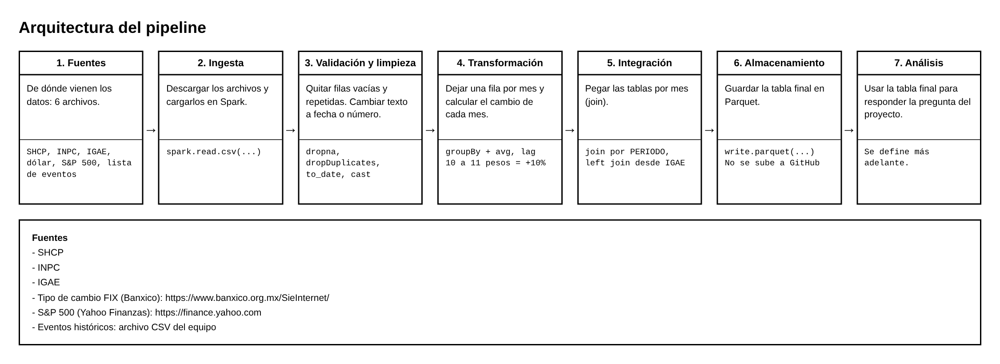

# Impacto de Eventos Macroeconómicos Globales en la Economía Mexicana: Un Análisis Multidimensional con PySpark

## ¿De qué trata este proyecto?

Cuando ocurre una crisis o un evento importante en el mundo, como una crisis financiera global o una pandemia, sus efectos no se quedan en el país donde empezó. México los siente en cosas cotidianas: el dólar se encarece o abarata, los precios suben, el gobierno recauda y gasta distinto, y la actividad económica se acelera o se frena.

Este proyecto busca medir y mostrar con datos cómo se transmiten esos golpes externos a la economía mexicana. Para eso reunimos información pública (finanzas públicas, inflación, actividad económica, tipo de cambio y bolsa de Estados Unidos) junto con una lista de eventos históricos, la limpiamos, la integramos mes a mes y la analizamos con herramientas diseñadas para trabajar con grandes volúmenes de datos. El periodo de análisis incluye episodios como las crisis de 1994, 2008 y 2020.

¿Por qué importa? Entender cuánto y cuándo reacciona la economía ante eventos globales ayuda a identificar qué tan vulnerable es México frente a la incertidumbre internacional y a leer con mejor criterio los momentos de volatilidad.

Utilizando **Apache Spark (PySpark)** como motor de procesamiento distribuido, se integran series de tiempo históricas de finanzas públicas, precios y actividad económica nacional con indicadores financieros internacionales clave.

## Pregunta de investigación
¿Cómo impactan los principales eventos históricos y crisis globales en la economía mexicana, medido a través de las variaciones del tipo de cambio frente al dólar y el comportamiento del índice S&P 500?

## Objetivo general
Construir un pipeline distribuido con PySpark que permita analizar la correlación y el impacto de variable externas de la economía global en la estabilidad económica de México.

---

## Fuentes de Información 
El proyecto parte de 6 archivos. El detalle de cada fuente (variables, periodicidad, justificación y alternativas evaluadas) está en [docs/fuentes.md](docs/fuentes.md).
### Fuentes Base del Curso 
1. **SHCP (Finanzas Públicas):** Ingresos (`XBB`) y Gastos (`XBC`) del Gobierno Federal. (`XBB` y `XBC` son las claves de las series).
2. **INEGI (INPC):** Índice Nacional de Precios al Consumidor para deflactación y cálculo de inflación. 
3. **INEGI (IGAE):** Indicador Global de la Actividad Económica por sectores productivos.

### Fuentes Adicionales Integradas 
1. **Tipo de Cambio USD/MXN:** Banco de México, serie SF43718. Indicador de presión cambiaria y volatilidad monetaria externa.
2. **Índice S&P 500:** Indicador de apetito por riesgo y comportamiento de los mercados financieros globales. Se obtendrá con la librería `yfinance` de Yahoo Finanzas (símbolo `^GSPC`), como se justifica en [docs/fuentes.md](docs/fuentes.md).
3. **Eventos históricos:** Archivo CSV que elaboraremos como equipo con las crisis y eventos globales a contrastar con las series. Especificando los eventos identificables.

---

### Cómo obtener los datos
 
Los datos originales **no se almacenan en este repositorio**. Para reproducir el proyecto, descárguenlos y colóquenlos en `data/raw/`.

| Fuente | Acceso | Periodicidad | Cobertura | Archivo en `data/raw/` |
| --- | --- | --- | --- | --- |
| Tipo de cambio FIX (Banxico, SF43718) | Notebook [01_descarga_tipo_cambio.ipynb](notebooks/01_descarga_tipo_cambio.ipynb), que usa la API REST del SIE (https://www.banxico.org.mx/SieAPIRest/service/v1/). Requiere token gratuito | Diaria (se agrega a mensual en la etapa 4) | 12-nov-1991 a la fecha de ejecución | `tipo_cambio_fix.csv` |
| S&P 500 (`^GSPC`) | Librería `yfinance` de Yahoo Finanzas (`pip install yfinance`), sin token. Aún no hay notebook de descarga | Diaria (se agrega a mensual en la etapa 4) | Desde 1927 | **[Por definir]** |
| Eventos históricos | CSV elaborado por el equipo (por desarrollar) | No aplica | Desde 1990 a 2026 | **[Por definir]** |
| IGAE (INEGI) | [A través del INEGI.] (https://www.inegi.org.mx/temas/igae/) | Mensual | Desde 1993 | **[Por definir]** |
| Ingresos y gastos (SHCP) | [Datos abiertos de la SHCP] (https://www.datos.gob.mx/organization/secretaria_hacienda) y series (`XBB`, `XBC`) | Mensual | Desde 2011 | **[Por definir]** |
| INPC (INEGI) | A través del INEGI. (https://www.inegi.org.mx/temas/inpc/) | Mensual | **[Por definir]** | **[Por definir]** |
 
**Token de la API de Banxico:** no se sube al repositorio. Cada integrante debe solicitar su propio token gratuito en el sitio del SIE y guardarlo en la variable de entorno `BANXICO_TOKEN`, que es la que lee el notebook:
 
```bash
# macOS / Linux
export BANXICO_TOKEN="<su_token>"
 
# Windows (PowerShell)
$env:BANXICO_TOKEN = "<su_token>"
````

---

## Resultados esperados
 
1. **Integración de datos:** una base consolidada que une una fuente financiera o global con las tres bases requeridas (SHCP, INPC, IGAE), construida de forma automatizada con PySpark.
2. **Indicadores:** cálculo de rendimientos y/o un índice que resalte los puntos de inflexión y los cambios bruscos en el mercado.
3. **Visualización:** una línea de tiempo (timeline) o buscador visual que muestre el comportamiento anómalo de los datos en respuesta a los eventos históricos globales. 

## Arquitectura y etapas del procesamiento
 

 
*Diagrama completo en [docs/arquitectura.png](docs/arquitectura.png).*
 
El pipeline tiene siete etapas, de las fuentes al análisis:
 
| Etapa | Qué se hace | Herramientas | Dónde vive |
| --- | --- | --- | --- |
| 1. Fuentes | Se reúnen los 6 archivos de origen: SHCP, INPC, IGAE, dólar, S&P 500 y lista de eventos | N/A | `data/raw/` |
| 2. Ingesta | Descargar los archivos y cargarlos en Spark | `spark.read.csv(...)` | Descarga: `notebooks/`. Lectura en Spark: **[Por definir]** |
| 3. Validación y limpieza | Quitar filas vacías y repetidas; cambiar texto a fecha o número | `dropna`, `dropDuplicates`, `to_date`, `cast` | **[Por definir]** |
| 4. Transformación | Dejar una fila por mes y calcular el cambio de cada mes | `groupBy` + `avg`, `lag` | **[Por definir]** |
| 5. Integración | Unir las tablas por mes | `join` por `PERIODO`, *left join* desde IGAE | **[Por definir]** |
| 6. Almacenamiento | Guardar la tabla final en Parquet (no se sube a GitHub) | `write.parquet(...)` | `data/processed/` |
| 7. Análisis | Usar la tabla final para responder la pregunta del proyecto | Se define más adelante | `reports/` |
 
**Ejemplo del cálculo de la etapa 4:** si el dólar pasa de 10 a 11 pesos de un mes al siguiente, el cambio mensual es +10 %.
 
**¿Por qué *left join* desde el IGAE?** Las series tienen coberturas distintas: tipo de cambio desde 1991, IGAE desde 1993 y finanzas públicas desde 2011. Un *inner join* recortaría el análisis a 2011 en adelante y dejaría fuera las crisis de 1994 y 2008. Los meses sin datos de finanzas quedan como nulos documentados.

---
 
## Estado actual del desarrollo
 
| Componente | Estado | Comentario |
| --- | --- | --- |
| Definición del proyecto y roles | Terminado | [docs/roles.md](docs/roles.md) |
| Fuentes de datos (selección y justificación) | Terminado | [docs/fuentes.md](docs/fuentes.md) |
| Diagrama de arquitectura | Terminado | [docs/arquitectura.png](docs/arquitectura.png) |
| Descarga del tipo de cambio (Banxico) | Terminado | [Notebook 01](notebooks/01_descarga_tipo_cambio.ipynb): 8,791 registros, del 12-nov-1991 al 03-nov-2026, guardados en `data/raw/tipo_cambio_fix.csv` |
| Descarga del S&P 500 | **[Por definir]** | |
| Archivo de eventos históricos | **[Por definir]** | |
| Código reutilizable en `src/` | No iniciado | `src/` solo contiene `.gitkeep` |
| Ingesta en Spark, validación y limpieza | **[Por definir]** | |
| Transformación e integración final | **[Por definir]** | |
| Almacenamiento en Parquet | **[Por definir]** | |
| Análisis y visualización | No iniciado | Se define más adelante |
| Guía de optimización | En curso (Actividad 10) | [docs/guia_optimizacion.md](docs/guia_optimizacion.md) |
 
---
 
## Estructura del repositorio
 
```text
Proyecto_Integrador_PGBD/
├── data/                # Datos de entrada y procesados (no se suben a GitHub)
│   ├── raw/             # Datos originales
│   └── processed/       # Datos transformados (Parquet)
├── src/                 # Código reutilizable (por ahora solo .gitkeep)
│   ├── ingestion/       # Lectura y carga (por crear)
│   ├── transformations/ # Limpieza e integración (por crear)
│   └── quality/         # Validaciones (por crear)
├── notebooks/           # Exploración y pruebas
├── docs/                # Arquitectura, fuentes, roles y guía de optimización
├── reports/             # Resultados y evidencias
├── README.md            # Presentación y navegación
├── requirements.txt     # Dependencias
└── .gitignore           # Exclusiones de Git
```
 
> Las subcarpetas de `src/` se crearán conforme se agregue código.
 
---
 
## Tecnologías utilizadas
 
- **Lenguajes y entorno:** Python 3.14, Jupyter Notebook.
- **Procesamiento distribuido:** Apache Spark (PySpark): DataFrames, Catalyst Optimizer, Spark UI.
- **Descarga y manejo de datos:** `requests` y `pandas` (API de Banxico), `yfinance` (S&P 500).
- **Almacenamiento:** formato Parquet.
- **Control de versiones y colaboración:** Git y GitHub (estrategia Feature-Branch / Pull Requests).
 
### Cómo ejecutar el proyecto
 
```bash
# 1. Clonar el repositorio
git clone https://github.com/JuliaDomRuss/Proyecto_Integrador_PGBD.git
cd Proyecto_Integrador_PGBD
 
# 2. Instalar dependencias
pip install -r requirements.txt
 
# 3. Configurar el token de Banxico (ver "Cómo obtener los datos")
export BANXICO_TOKEN="<su_token>"
 
# 4. Abrir los notebooks y ejecutar en orden, empezando por la descarga
jupyter notebook notebooks/
```

---
 
## Flujo de trabajo en GitHub
 
Ningún integrante hace `push` directo a `main`: cada cambio va en una rama (por ejemplo `docs/actualizacion-readme`) y se integra con un Pull Request semanal. Los detalles y reglas están en [docs/roles.md](docs/roles.md).
 
---
 
## Documentación
 
- [Arquitectura](docs/arquitectura.png)
- [Fuentes de datos](docs/fuentes.md)
- [Roles y reglas de colaboración](docs/roles.md)
- [Guía de optimización](docs/guia_optimizacion.md) *(se crea en la Actividad 10)*
- [Notebook 01: descarga del tipo de cambio](notebooks/01_descarga_tipo_cambio.ipynb)
---
 
## Integrantes y roles
 
| Integrante | Rol principal | Área de responsabilidad general |
| --- | --- | --- |
| **Julia María Domínguez Russell** | **Developer Lead** | Coordinación técnica de código PySpark, arquitectura de DataFrames y buenas prácticas de desarrollo. |
| **Arturo Alberto Martín del Campo Flores** | **Technical Reviewer 1** | Revisión de código, validación de lógica en PRs e integración de ramas a `main`. |
| **Louis Frederic J. Dangremont** | **Technical Reviewer 2** | Revisión de código, pruebas de ejecución e integración de ramas a `main`. |
| **Alisson Jazmín García Cardenas** | **Documentation Lead** | Coordinación de documentación técnica, estructura Markdown, citas bibliográficas y reportes. |
 