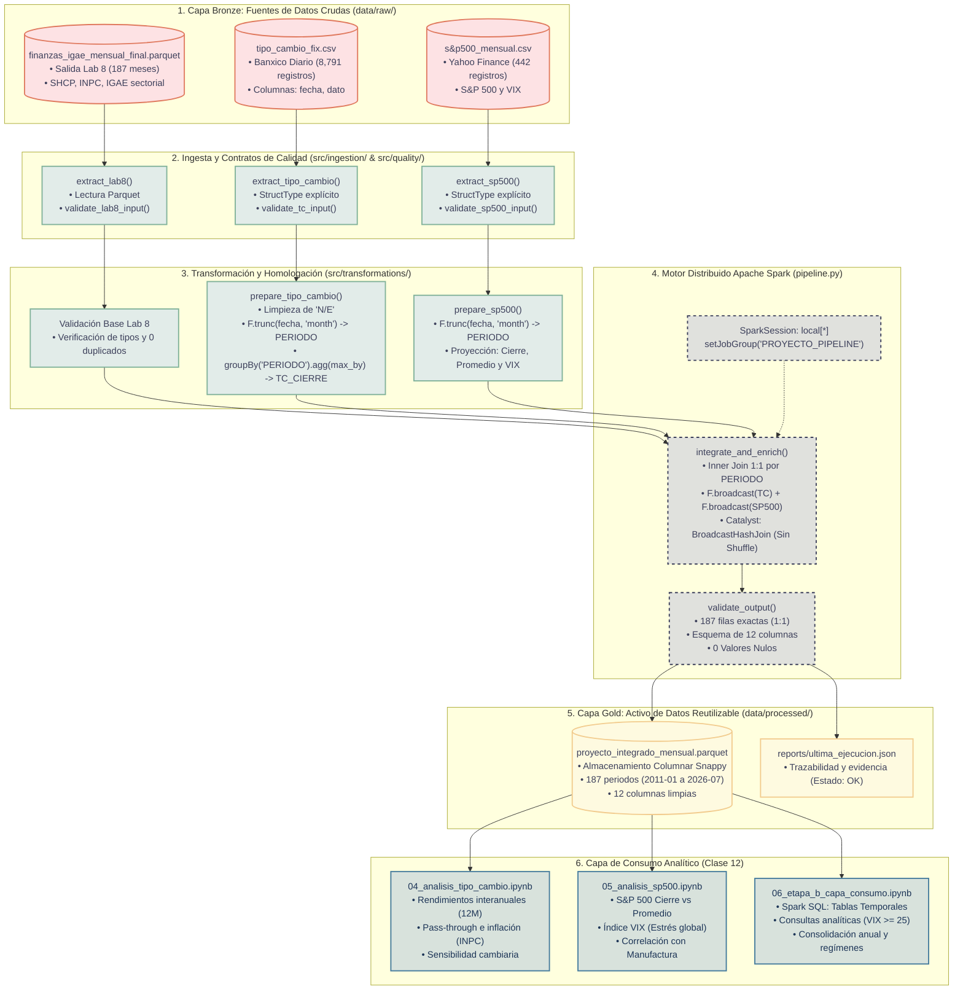

# Actividad 12 — Etapa D: Arquitectura de Datos Aplicada y Gobernanza

Este documento detalla la arquitectura de extremo a extremo implementada en el Proyecto Integrador, explicando el recorrido de la información, el desacoplamiento entre cómputo y almacenamiento, y el código formal para representar el flujo en un diagrama visual.

---

## 1. Recorrido End-to-End del Dato

```text
FUENTES CRUDAS         INGESTA Y VALIDACIÓN          TRANSFORMACIÓN Y LIMPIEZA         INTEGRACIÓN (CATALYST)        ALMACENAMIENTO (GOLD)         CAPA DE CONSUMO
(APIs / Descargas)     (src/ingestion/extract.py)    (src/transformations/)             (pipeline.py)                 (data/processed/)             (notebooks/ + SQL)

  SHCP + INPC + IGAE ──> extract_lab8()           ──> Validación Lab8 (validate.py) ──┐
  (Parquet Lab 8)                                                                     │
                                                                                      ├──> Inner Join 1:1           ──> proyecto_integrado_       ──> 04_analisis_tc
  Banxico FIX (Diario)─> extract_tipo_cambio()    ──> prepare_tipo_cambio()         ──┤    (BroadcastHashJoin)          mensual.parquet               05_analisis_sp500
  (8,791 filas CSV)      (StructType explícito)        (Filtro N/E + max_by Cierre)   │    (Sin Exchange en cruce)      (187 filas, 12 columnas,      06_etapa_b_consumo
                                                                                      │                                  0 nulos, columnar snappy)    (Spark SQL / BI)
  Yahoo Finance       ──> extract_sp500()          ──> prepare_sp500()               ──┘
  (S&P 500 + VIX CSV)    (StructType explícito)        (Cierre, Promedio y VIX)
```

---

## 2. Organización Lógica bajo el Modelo Medallion

Siguiendo las mejores prácticas de la **Clase 12**, los datos se organizan en tres capas de madurez:

1. **Capa Bronze (Datos Crudos e Inmutables):**
   * **Archivos:** `data/raw/tipo_cambio_fix.csv`, `data/raw/s&p500_mensual.csv` y `data/raw/finanzas_igae_mensual_final.parquet`.
   * **Propósito:** Conservar las fuentes tal cual fueron descargadas desde Banxico y Yahoo Finance, garantizando resiliencia y auditoría ante reprocesamientos futuros.
2. **Capa Silver (Limpieza y Homologación de Claves):**
   * **Lógica:** Implementada en `src/transformations/integrate_enrich.py`.
   * **Operaciones:** Filtrado de valores inválidos (`N/E`), casteo tipado, agregación de serie diaria a mensual (`groupBy(PERIODO).agg(max_by)`), homologación temporal mediante `F.trunc(..., "month")` para asegurar exactamente 1 fila por mes calendario.
3. **Capa Gold (Activo de Datos de Negocio):**
   * **Archivo:** `data/processed/proyecto_integrado_mensual.parquet`.
   * **Características:** 187 registros mensuales (2011-01 a 2026-07) con 12 columnas consolidadas y 0 valores nulos. Es la única fuente de verdad optimizada para consumo analítico y modelado.

---

## 3. Desacoplamiento de Cómputo y Almacenamiento

* **Motor de Cómputo (Transitorio):** Apache Spark opera como el motor de trabajo pesado. Se inicializa bajo demanda (`spark-submit`), ejecuta el DAG optimizado por Catalyst, valida los datos y se apaga limpiamente al persistir el Parquet.
* **Persistencia Inmutable (Permanente):** El almacenamiento en **formato columnar Parquet** proporciona una alta compresión de almacenamiento y permite el salto de filas/columnas (*Projection Pruning* y *Predicate Pushdown*) al momento de la consulta.
* **Reutilización del Esfuerzo (Write Once, Read Many):** La integración costosa de fuentes se realiza **una sola vez** en el pipeline. Los analistas y científicos de datos consultan la Capa Gold tantas veces como sea necesario utilizando Spark SQL o Pandas sin tener que volver a limpiar ni cruzar los archivos crudos.

---

## 4. Estrategia de Mantenimiento y Evolución Arquitectónica

* **Mantenimiento Actual (Sobreescritura Idempotente):** Dado el tamaño compacto del dataset (187 periodos mensuales), el pipeline utiliza sobreescritura controlada (`mode("overwrite")` con verificación previa) garantizando reproducibilidad sin acumular registros duplicados.
* **Incorporación de Nuevos Datos:** Para agregar nuevos meses de información (ej. actualizaciones mensuales de Banxico o SHCP), se incorporan las nuevas filas al archivo crudo en `data/raw/` y se ejecuta el pipeline modular. Los contratos de `validate.py` confirmarán que la cobertura temporal se amplió sin duplicar meses previos.
* **Evolución hacia Lakehouse / Data Warehouse:** En un escenario de producción industrial con millones de registros y flujos en tiempo real, la solución evolucionaría reemplazando el archivo Parquet estándar por **Delta Lake**, habilitando operaciones transaccionales ACID (`MERGE INTO` para cargas incrementales sin sobreescritura total), control de versiones (*Time Travel*) y esquemas gobernados.

---

## 5. Código del Diagrama de Arquitectura (Mermaid)

El siguiente bloque de código está escrito en sintaxis estándar de **Mermaid**. Puedes copiarlo e insertarlo directamente en páginas web como **[mermaid.live](https://mermaid.live/)** para generar y descargar el diagrama en formato **PNG** o **SVG**, o pegarlo dentro del `README.md` de GitHub (donde se renderiza automáticamente como diagrama gráfico interactivo):


